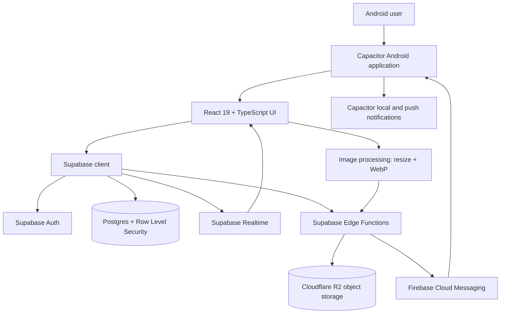

# Swapply — Technical Architecture

This document summarizes the architecture described by the Swapply project README, package manifest and documented source layout. It intentionally omits private implementation code, credentials, project identifiers and secret configuration values.

## 1. High-level architecture

Swapply is a React/TypeScript application packaged for Android using Capacitor. Supabase provides authentication, Postgres data, Row Level Security, Realtime and Edge Functions. Cloudflare R2 stores product images; Firebase Cloud Messaging is integrated for push delivery when the app is closed.



## 2. Client application

The app uses React 19, TypeScript and Vite, with React Router for navigation. The documented source organization separates:

- **Pages:** marketplace, search, listing form, product details, offers, offer composer, chat, dashboard, favourites, admin, profile, authentication, auth callback and privacy.
- **Reusable components:** navigation, product tiles, category chips, filter controls, offer toast, favourites control, report dialog and password input.
- **Domain modules:** products, offers, messages, favourites, moderation, notifications, uploads, camera and image handling.
- **Shared contexts/utilities:** Supabase client, authentication/session context, theme, categories and deep-link parsing.

This modular organization separates screen composition from domain operations and backend communication.

## 3. Android integration

Capacitor 7 packages the web application as an Android app. The project documents use of Capacitor integrations for:

- App lifecycle and incoming deep links
- Camera and photo selection
- Local notifications
- Push notification registration
- Status bar behavior

The Android application ID documented by the project is `com.swapply.app`. Email confirmation callbacks use the custom scheme `com.swapply.app://auth/callback`. The app handles incoming links on warm and cold start and delegates confirmation validation to Supabase.

## 4. Authentication and authorization

Supabase Auth manages user identity and sessions. The app includes authentication context and dedicated callback/confirmation handling.

Database access is protected using Postgres Row Level Security policies. Administrative access is represented in the backend and is checked through a database-side admin function; UI route gating is not the sole security boundary.

The public portfolio does not publish credentials, access tokens, service-role keys, or private project configuration.

## 5. Database and domain model

The repository documentation identifies migrations for these domain areas:

- Profiles and categories
- Products and product images
- Swap offers and offer items
- Conversations and messages
- Favourites
- Reports and notifications
- Device tokens and member blocking
- Administrative capabilities

Migrations are versioned under `supabase/migrations/`. Row Level Security is used to constrain user access. The complete private schema and SQL are intentionally not reproduced in this public portfolio.

### Exchange lifecycle

The documented exchange engine supports offer creation, responses, automatic reservation behavior and completion. Swapply is an exchange platform, not a payment processor. Any cash difference is an agreement between the users; the application does not process the payment.

## 6. Realtime messaging and notifications

The documented notification architecture combines:

1. Supabase Realtime events for offer changes and chat messages.
2. In-app offer badges and toast notifications.
3. Capacitor local notifications while the Android app is running.
4. Firebase Cloud Messaging for closed-app push delivery through a Supabase Edge Function.

Device tokens are registered through a backend RPC and associated with the signed-in user. The server-side push function validates the caller and derives the intended recipient from the relevant offer or message rather than trusting an arbitrary client-supplied recipient.

## 7. Image upload and storage

The client selects an image using the camera/gallery integration, resizes it and compresses it to WebP. It requests a short-lived presigned upload URL from a Supabase Edge Function, then uploads the image directly to Cloudflare R2. The database stores the object key rather than R2 credentials.

R2 access credentials are held as server-side Edge Function secrets. They must never be embedded in the Android client or committed to the public portfolio.

## 8. Moderation and safety controls

The project documents:

- User-submitted reports for listings
- Administrative review and resolution of reports
- Listing hide/remove/restore actions
- Member suspension/reactivation
- Member blocking and unblocking
- Backend enforcement that prevents blocked members from exchanging offers or messages

These capabilities combine frontend controls with database-side authorization policies.

## 9. UI theme

The app uses a retro 1980s/1990s arcade-inspired visual identity, not a distressed vintage aesthetic. The documented palette includes turquoise, green, cream, blue, orange, navy and yellow. Semantic CSS tokens support light and dark themes. Locally bundled fonts include Space Grotesk, Pixelify Sans and Silkscreen, with pixel fonts reserved for display and micro-labels.

### Home-page brand lockup (latest UI update)

The centered Home header now gives the brand name visual priority: `SWAPPLY` is rendered in the Silkscreen display face at 34 px with `0.04em` letter spacing. Its line box is fixed at 30 px so the larger glyphs do not increase the header's overall height or shift the content below it. The supporting “Swap what you have” tagline is rendered at 13 px in Space Grotesk, weight 500, using the muted semantic text colour. Both lines remain centered on the same horizontal axis. This styling is scoped to the centered Home header; Search keeps its existing eyebrow/heading hierarchy and left-aligned layout.

## 10. Build and release workflow

The documented developer workflow is:

```powershell
npm install
npm run build
npx cap sync android
npx cap open android
```

The native Android project can be built with Android Studio or Gradle. Release signing files and machine-specific configuration are private and excluded from the public portfolio.

## 11. Security and privacy boundaries

- Supabase service-role credentials remain server-side.
- R2 secrets are used only by the presigning Edge Function.
- Firebase service-account credentials are stored as backend secrets, not in the public client repository.
- Android signing keystores and signing properties are private.
- Row Level Security and server-side validation enforce authorization.
- This public document describes architecture without exposing private SQL, secrets, or sensitive configuration.

## Scope and verification note

This is a portfolio-level architecture summary derived from project documentation and dependency/source organization. It is not a security audit, penetration test, independent code review, or guarantee that every external service is currently deployed and operational.
