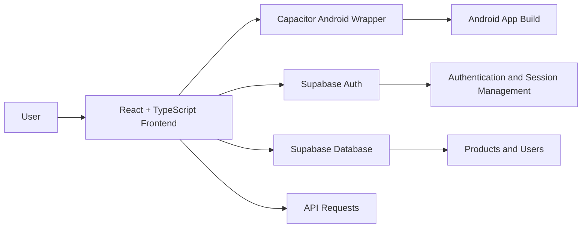

# Swapply Architecture

This document describes the current architecture for the public portfolio version of Swapply. It distinguishes between architecture that is known or verified and architecture that is proposed, intended, or still being defined.

## 1. Application Architecture Overview

The application is intended to provide a user-focused product exchange experience for Android users, with emphasis on direct swaps and value balancing between exchanged items.

### Verified / Publicly Documented

- React-based frontend for the user interface
- TypeScript for app logic and maintainability
- Capacitor for Android packaging and mobile app delivery
- Supabase as the backing platform for authentication and data services

### Proposed / To Be Confirmed

- Detailed frontend state management patterns
- Advanced modular architecture for product flows
- Real-time notification infrastructure
- Image optimization and cloud media workflow
- Production deployment process and CI/CD pipeline

## 2. Frontend Architecture

The frontend is expected to be built around a component-driven user experience that supports:

- Product discovery
- Product listing creation
- Swap request and agreement flow
- User account management
- Mobile-friendly layout and navigation

This layer should remain lightweight, maintainable, and optimized for Android devices packaged with Capacitor.

## 3. Android Integration

Capacitor is used as the bridge between web application code and Android deployment.

This allows:

- A web app to be packaged as a mobile application
- Android-focused configuration and build preparation
- Native app delivery while keeping a web-first development workflow

The application can be improved further with Android-specific UX and packaging optimizations when needed.

## 4. Authentication Architecture

Authentication is expected to be managed through Supabase, which supports secure user-based access patterns and identity management.

Possible authentication workflows include:

- Sign up and sign in
- Email verification
- Session handling
- User profile access control

The exact authentication flow should be documented after implementation is confirmed.

## 5. Backend and Database Architecture

The public portfolio should only describe the backend model at a high level unless actual implementation details are confirmed.

Expected architecture:

- Supabase database for storing user and product-related data
- Application logic interacting with frontend services through API calls
- Secure access patterns and role-aware permissions where implemented

The final database schema and backend structure should be added once the application is fully documented.

## 6. API Communication

The application is expected to communicate with backend services through REST-based or Supabase-driven API calls.

Typical responsibilities:

- Fetch user data
- Retrieve product listings
- Create and update product records
- Submit swap proposals
- Handle authentication events

## 7. Image Storage

Image storage requirements are not yet confirmed in the public portfolio version.

Possible approaches include:

- Supabase storage for user-uploaded product images
- Managed object storage for posting media assets
- Local application storage for temporary or cached resources

This section should only be finalized after the actual implementation is verified.

## 8. Push Notifications

Push notifications are not documented as confirmed in the public portfolio version.

If implemented later, this would likely involve:

- Notification trigger events
- User preference settings
- Background or foreground delivery flow
- Android-specific notification handling

## 9. Security Considerations

The public repository must not contain any private credentials or sensitive configuration.

Security practices should include:

- Avoiding secret files in public repositories
- Using environment variables only in secure local or deployment environments
- Keeping API keys, service-role credentials, and signing details out of the repo
- Minimizing exposure of private app logic or backend configuration

## 10. Build and Deployment Workflow

A typical public-safe workflow would look like this:

- Frontend development in React + TypeScript
- Android packaging through Capacitor
- Supabase configuration for auth and data work
- Build verification and app testing
- Release preparation and APK packaging

The actual workflow should be revised when the app is ready for deployment documentation.

## Mermaid Diagram

## Summary

Swapply's architecture is currently documented at a high level to protect application privacy while still presenting a credible and professional project overview.

The architecture should be updated over time to reflect verified implementation details, real deployment decisions, and the final software design of the application.

